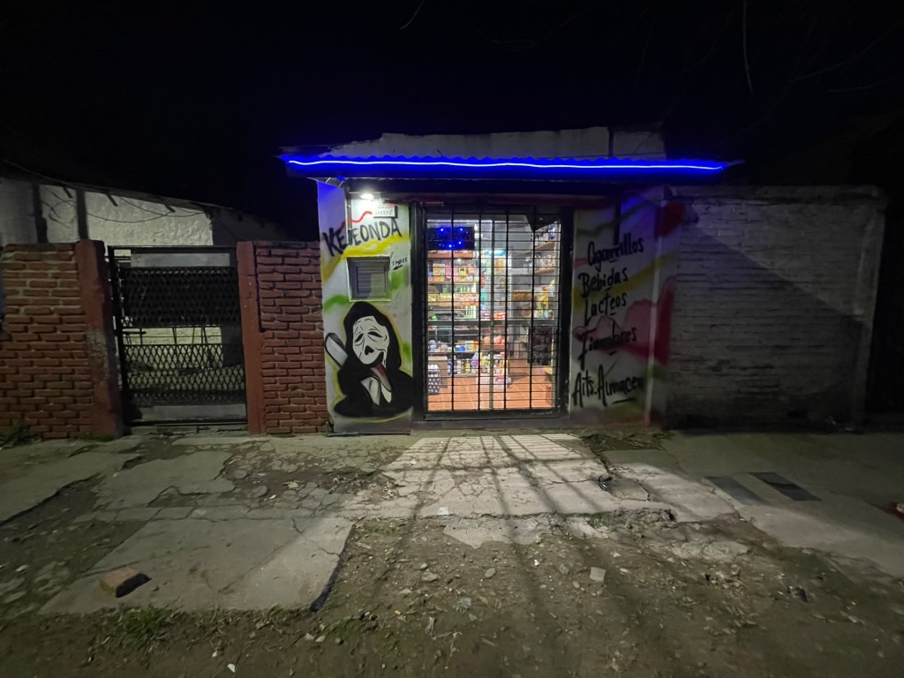

# 🏪 KEE ONDA | CRM & ERP para Kiosco & Almacén

Sistema integral de gestión comercial, punto de venta (POS) de alta velocidad, administración de inventario con lector de código de barras, finanzas desacopladas, control de turnos y sincronización en tiempo real con **Supabase**.



---

## 🚀 Características Principales

1. **Punto de Venta (POS) Táctil & Barcode Scanner:**
   - Diseñado para máxima velocidad sin imágenes.
   - Detección global de escaneo de código de barra USB/Bluetooth con bip electrónico vía Web Audio API.
   - Atajos de teclado: `F12` / `Ctrl + Enter` para cobro inmediato con **cero scroll**.
   - Calculadora de vuelto y generador de tickets térmicos imprimibles.
2. **Historial de Ventas & Anulaciones:**
   - Sección dedicada e independiente para consultar tickets.
   - Anulación de ventas erróneas con **reposición automática de stock** en inventario y descuento contable.
3. **Finanzas & Gastos Operativos:**
   - Registro de egresos por categorías (Luz Edenor/Edesur, Gas, Alquiler, Proveedores, Sueldos, Impuestos).
   - Registro de ingresos adicionales (Comisiones SUBE, cargas virtuales, aportes de capital).
   - Exportación de libros contables a CSV.
4. **Dashboard Analítico Configurable:**
   - Filtros de fecha: Hoy, Día Específico, Esta Semana, **N Semanas personalizables (ej. 6 Semanas)**, Mes y Año.
   - Gráficos interactivos con selector individual de formato: **Barra, Dona, Círculo/Torta, Línea**.
   - Conmutador a vista porcentual (`%`) en cada gráfico.
5. **Clientes & Cuenta Corriente (CRM / "Fiar"):**
   - Control de cuentas de vecinos con límite de crédito y registro de abonos.
6. **Control de Caja & Turnos:**
   - Arqueo de turno con fondo inicial y cálculo de sobrante/faltante.
7. **Diseño & Marca:**
   - Menú lateral en rojo oscuro (`#7a0c1a`) con logo circular pulido.
   - Fondo blanco limpio de alto contraste y botón conmutador a **Modo Noche (Dark Mode)**.

---

## 🛠️ Tecnologías

- **Frontend:** React 19, Vite, Tailwind CSS
- **Iconografía:** Lucide React
- **Gráficos:** Chart.js & React-Chartjs-2
- **Efectos:** Canvas-Confetti, Web Audio API
- **Base de Datos & Backend:** Supabase (PostgreSQL + Realtime)
- **Despliegue:** Vercel (con `vercel.json` SPA routing)

---

## 🗄️ Configuración de Supabase

1. Crea un nuevo proyecto en [Supabase](https://supabase.com).
2. Ve al **SQL Editor** y ejecuta el script completo ubicado en:
   ```
   supabase/schema.sql
   ```
   *Este script crea todas las tablas (`products`, `categories`, `customers`, `suppliers`, `sales`, `sale_items`, `finances`, `cash_shifts`), índices, políticas RLS y habilita las publicaciones Realtime.*
3. Copia tus credenciales en el archivo `.env`:
   ```env
   VITE_SUPABASE_URL=https://tu-proyecto.supabase.co
   VITE_SUPABASE_ANON_KEY=tu-anon-key-publica
   ```

---

## 📦 Despliegue en Vercel

El proyecto incluye `vercel.json` listo para producción.

1. Conecta este repositorio en [Vercel](https://vercel.com).
2. Configura las dos Variables de Entorno en Vercel:
   - `VITE_SUPABASE_URL`
   - `VITE_SUPABASE_ANON_KEY`
3. Framework Preset: **Vite**
4. Build Command: `npm run build`
5. Output Directory: `dist`
6. ¡Listo para usar en cualquier terminal, tablet o PC de mostrador!
